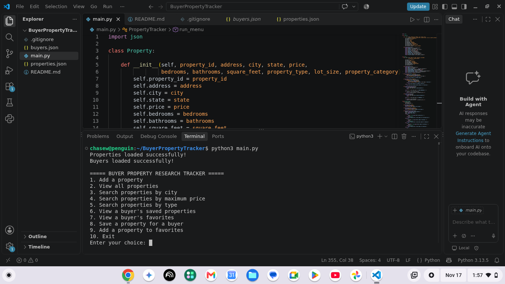
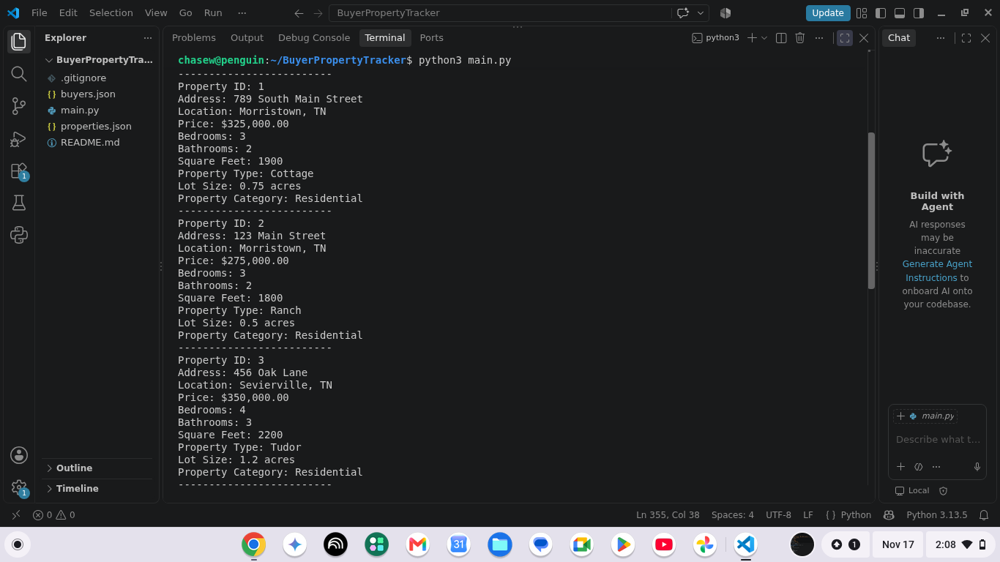
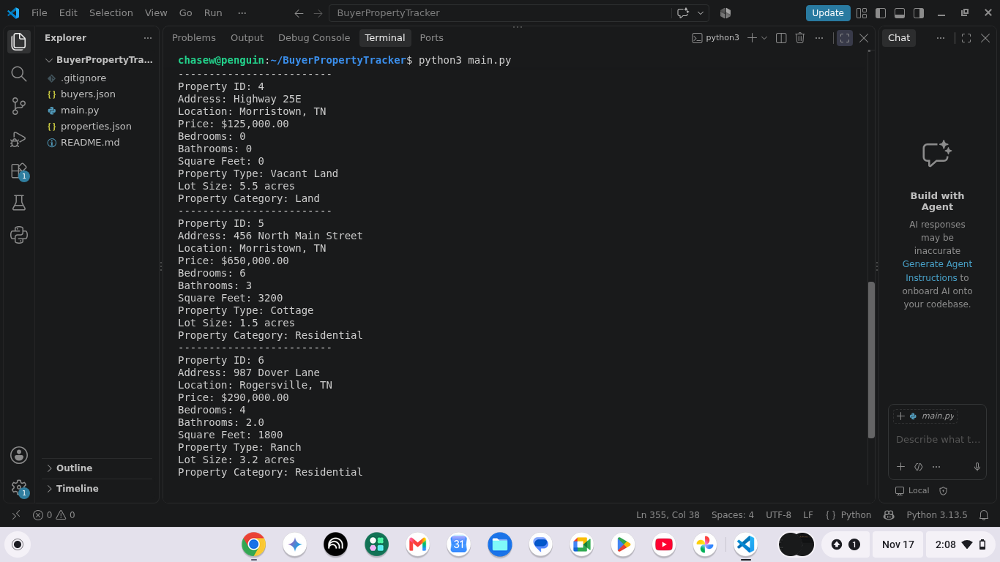

# Buyer Property Research Tracker

## Project Overview

The Buyer Property Research Tracker is a Python-based application designed to help organize property research for multiple potential real estate buyers.

The program allows users to manage property information, track buyer preferences, save properties for individual buyers, and organize favorite properties.



## Property Listings





## Features

- Add and store property information.
- View all tracked properties.
- Search properties by city, maximum price, and property type.
- Manage multiple buyers.
- Store buyer preferences.
- Save properties for individual buyers.
- Add properties to a buyer's favorites.
- Save and load property and buyer information using JSON files.
- Validate numeric inputs to prevent invalid entries.

## Technologies Used

- Python
- JSON
- Object-Oriented Programming
- File Handling
- Input Validation

## How to Run

1. Make sure Python 3 is installed.
2. Download or clone this repository.
3. Open the project folder in a terminal.
4. Run the following command:

```bash
python3 main.py
```

## What I Learned

Through this project, I practiced:

- Creating and working with Python classes and objects.
- Using lists and dictionaries.
- Working with JSON files.
- Saving and loading persistent data.
- Building a menu-driven application.
- Handling invalid user input.
- Organizing a larger Python project.

## Project Status

Completed as an independent learning project. Additional improvements may be made in the future.
